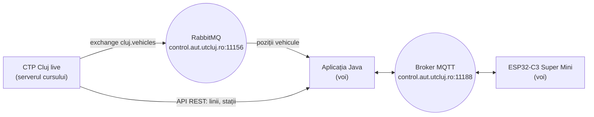

# Tema 04 – Tracker personal de autobuz pe ESP32-C3

**Tehnologii:** ESP32-C3 Super Mini, Arduino IDE, FreeRTOS, MQTT, RabbitMQ, Java 17+
**Termen de predare:** _de stabilit_

## Obiective

După rezolvarea temei, veți putea să:

- consumați un flux de date reale dintr-un **exchange fanout RabbitMQ**;
- legați două sisteme de mesagerie: **RabbitMQ** pe partea de server și **MQTT** spre dispozitiv;
- proiectați singuri taskurile **FreeRTOS** ale unui dispozitiv și să le justificați alegerea;
- descrieți arhitectura unui sistem construit de voi, cu o diagramă.

## Problema

Construiți un **tracker personal de autobuz**: o placă ESP32-C3 care îl ajută pe utilizator să urmărească autobuzul dorit, cât de aproape este de stația lui și când trebuie să plece spre ea.

Ce face utilizatorul:

1. Alege într-o aplicație Java **linia** și **stația** pe care vrea să le urmărească.
2. Urmărește pe LED-ul plăcii cât de aproape este autobuzul.
3. Când urcă în autobuz, confirmă din butonul **BOOT**.

Datele sunt reale: pozițiile vehiculelor CTP Cluj, actualizate cam la 20 de secunde.

> **Notă:** Enunțul acestei teme este **deliberat sumar**. Spre deosebire de temele anterioare, nu primiți un proiect de start și nici o specificație detaliată. Funcționalitatea concretă a tracker-ului o propuneți voi: ce vede utilizatorul, ce înseamnă LED-ul și butonul, ce calculează aplicația și ce calculează placa, cum arată mesajele și cum împărțiți aplicația de pe placă în taskuri. Descrieți ce ați ales și de ce în documentația soluției.



## Sursa de date

Aplicația **CTP Cluj live** rulează pe serverul cursului și publică pozițiile vehiculelor în timp real. Harta este la <https://control.aut.utcluj.ro/publictransport/>.

**Cheia API și contul RabbitMQ le primiți la laborator. Nu le urcați pe GitHub.**

| Ce | Unde | Observații |
|----|------|------------|
| pozițiile vehiculelor | RabbitMQ: brokerul `control.aut.utcluj.ro`, portul `11156`, exchange-ul `cluj.vehicles` (`fanout`, nedurabil) | vă creați propria coadă și o legați de exchange; fiecare mesaj este un vehicul, în JSON, cu linia, poziția, viteza și momentul raportării |
| liniile | API REST: `https://control.aut.utcluj.ro/publictransport/api/lines` | cheia în headerul `X-API-Key` |
| traseul și stațiile unei linii | API REST: `/api/line?route_id=N` | la fel |

**Nu consumați din coada `ctp.cluj.vehicles`**: este comună, iar dacă mai mulți colegi citesc din ea în același timp, își împart mesajele și niciunul nu vede toată flota.

Datele reale au imperfecțiuni: poziții vechi, câmpuri lipsă, vehicule care dispar.

Pentru o descriere completă a aplicației **CTP Cluj live** există [ghidul de integrare](docs/ghid-integrare.md): toate endpoint-urile API-ului REST, toate destinațiile RabbitMQ (inclusiv parcările), câmpurile mesajelor și exemple Java de conectare. **Ghidul nu este necesar pentru rezolvarea temei**: ce vă trebuie este în tabelul de mai sus. A fost adăugat pentru a evidenția toate capabilitățile aplicației; oricare dintre aceste API-uri poate fi folosit, dar nu este obligatoriu.

## Resurse puse la dispoziție

- **RabbitMQ în Java:** [demo-rabbitmq](https://github.com/automatica-cluj/curs-ssatr-ia-v5/tree/main/exemple_curs/demo-rabbitmq), din exemplele cursului: un producător și doi consumatori pe un exchange fanout. Exemplul pornește un RabbitMQ local în Docker; pentru temă vă conectați la brokerul cursului.
- **MQTT în Java:** [`exemple/02-mqtt/`](../tema-01-iot-mqtt/exemple/02-mqtt/) din tema 01.
- **MQTT și taskuri pe ESP32-C3:** temele [02](../tema-02-esp32-mqtt/) și [03](../tema-03-semafor-simplu/). Partea de comunicație din scheletele lor (`connection.h`, `connection.cpp`: Wi-Fi, ora prin SNTP, MQTT) o puteți refolosi.
- **Exemple FreeRTOS:** [rt-labs-esp32c3](https://github.com/automatica-cluj/rt-labs-esp32c3), în primul rând laboratorul 6 (`lab6-task-patterns`).

## Cerințe

### 1. Aplicația Java

- Utilizatorul alege linia și stația din datele reale.
- Pozițiile vehiculelor se iau din **RabbitMQ**, printr-o coadă proprie legată de `cluj.vehicles`.
- Comunicarea cu placa se face prin **MQTT**, pe brokerul cursului, cu topic-urile sub `ssatr/<student>/`.

### 2. Tracker-ul ESP32-C3

- Aplicația de pe placă este organizată în **taskuri FreeRTOS**.
- Butonul BOOT se tratează printr-o **rutină de întrerupere**.
- LED-ul și butonul au o semnificație clară, aleasă de voi și descrisă în documentație.

### 3. Funcționarea completă

Sistemul trebuie să funcționeze cap-coadă: după alegerea liniei și a stației, tracker-ul urmărește o linie reală, iar confirmarea din butonul BOOT ajunge la aplicația Java.

### 4. Documentația

Un `README.md` care descrie soluția: arhitectura (cu o diagramă), mesajele MQTT, taskurile de pe placă, ce înseamnă LED-ul și butonul, cum se rulează.

## Predare

Soluția se află în fork-ul vostru, în folderul `tema-04-tracker-autobuz/`:

```
tema-04-tracker-autobuz/
└── solutie/
    ├── README.md             # documentația
    ├── aplicatie-java/       # proiectul Maven
    └── esp32_tracker/        # schița Arduino
```

**Nu urcați în fork cheia API, parola RabbitMQ sau parola rețelei voastre Wi-Fi.**

După push, adăugați commit ID-ul soluției (`git rev-parse HEAD`) ca **comentariu** la assignment-ul temei din **Microsoft Teams** și apăsați **Turn in**. Detalii în [README-ul principal](../README.md#predare).

## Bibliografie

- Cursul: [2.3 Eliberare periodică](https://control.aut.utcluj.ro:8030/part-02-time/03-periodic-release/), [3.2 Modelul de task](https://control.aut.utcluj.ro:8030/part-03-scheduling/02-task-model/)
- [RabbitMQ: Publish/Subscribe în Java](https://www.rabbitmq.com/tutorials/tutorial-three-java)
- [rt-labs-esp32c3](https://github.com/automatica-cluj/rt-labs-esp32c3): laboratorul 6 (`lab6-task-patterns`), `docs/freertos_concepts.md`
- [FreeRTOS: `xTaskDelayUntil`](https://www.freertos.org/Documentation/02-Kernel/04-API-references/02-Task-control/03-xTaskDelayUntil), [cozi](https://www.freertos.org/Documentation/02-Kernel/02-Kernel-features/02-Queues-mutexes-and-semaphores/01-Queues)
- [Arduino-ESP32: GPIO și întreruperi](https://docs.espressif.com/projects/arduino-esp32/en/latest/api/gpio.html)
